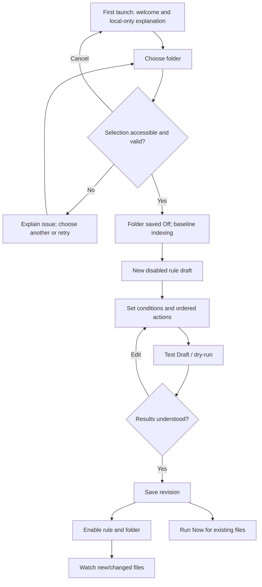
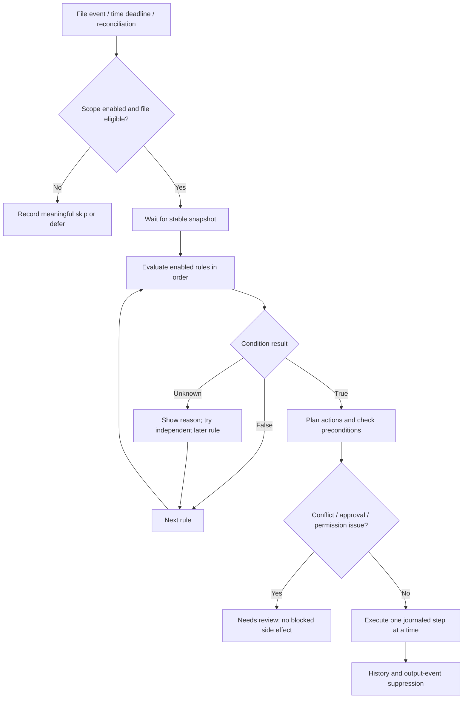
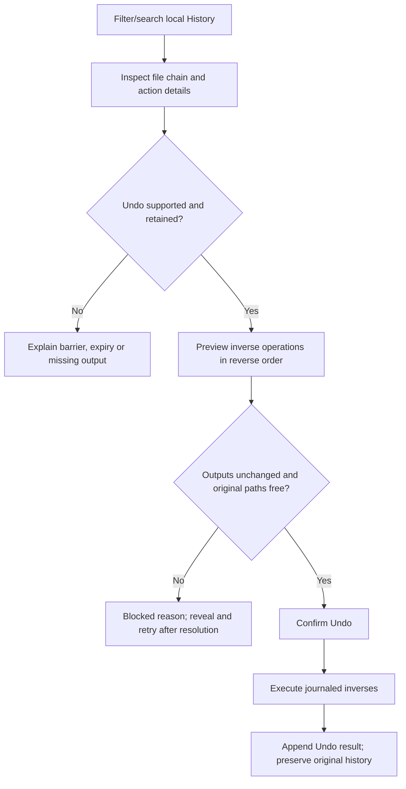

# Folder Master — User flows and screen contract

Status: behavior contract · 11 November 2026. [Option catalog](USER_OPTIONS.md) contains every configurable value/default; [PRD](PRD.md) contains scope and acceptance criteria. [UI/UX design](UI_UX_DESIGN.md) adds visual hierarchy, screen states and motion contracts. Diagrams describe required final behavior; the current synthetic storyboard covers only part of these flows. See PROGRESS.md for evidence.

## 1. Navigation and main window

```text
┌ Folder Master ───────────────────────── Preview…  Run Now…  Pause ┐
│ FOLDERS              │ RULES                  │ RULE DETAILS      │
│ + Add Folder         │ + New Rule             │ Name / Enabled    │
│ Downloads  • On      │ ☑ Invoices             │ Match All/Any/None│
│ Scans      ◷ Paused  │ ☐ Old installers       │ + Condition/Group │
│ Work       ! Offline│ ☑ Screenshots          │ Ordered actions   │
│                     │ drag or Move Up/Down   │ Stop / Continue   │
│ History             │                        │ Test Draft…       │
│ Settings            │                        │ Cancel   Save     │
└ Status, queue count, last run, actionable permission/error text ──┘
```

Folders show display name, path tooltip, automation toggle, and status. Rules show ordered priority, name, enabled state, and validation/capability indicator. Details distinguish saved rule from unsaved draft. Nothing runs as a result of selecting a row. Toolbar scope follows selected folder; all-folder scope is explicit in its sheet. History/Settings replace the content area while preserving selection. Narrow windows collapse sidebars before removing controls; inspector and tables scroll.

Standard commands: ⌘N new rule in selected folder; ⌘S save draft; ⌘, Settings; ⌘Q Quit; Delete in a rule list requests deletion of configuration, not files. Space toggles a focused checkbox. Move Up/Down available in context/menu actions with keyboard focus. Preview and Run Now use labeled controls instead of overloading a destructive shortcut. ⌘Z in text editing remains text undo; app operation undo uses explicit history/menu commands.

## 2. First launch → first enabled rule



1. Welcome explains processing stays local, close-window versus Quit, and manual preview. Choices: Add Folder, Open Settings, or close window. No automatic Desktop/Downloads access, login registration, notifications permission, scan of home directory, or file actions.
2. Add Folder opens native directory selection. Cancel creates nothing. Inaccessible, prohibited, duplicate or overlapping scope gives a specific inline reason. Choosing a different existing folder is a fresh selection, not a silent relocation.
3. Folder options sheet offers nickname, recursion, hidden files, exclusions and watcher mode. Save creates an Off folder. Baseline enumeration reads metadata without applying rules. A file arriving after this baseline is eligible only when automation is enabled; historical unchanged files require Run Now.
4. New Rule opens a disabled draft with an All condition root and empty action list. Choose condition fields/operators and action options. Save is disabled while invalid; errors point to exact fields. Leaving a dirty draft offers Save, Discard, Keep Editing.
5. Test Draft uses selected sample(s) or folder enumeration. It shows why files match, action destinations, unknown content and conflicts. No Apply control in a draft test. Back returns to the intact editor.
6. Save creates a revision. “Enable rule and folder” is explicit; guarded actions open capability acknowledgement if needed. Dismissing acknowledgement keeps the rule disabled. Merely enabling does not apply to historical files. Offer Run Now for existing files as a separate action.
7. First-time errors-only notifications can be enabled explicitly; refusal leaves in-app/menu errors available. Login launch is separately opt-in in Settings.

Empty states: no folders → Add Folder; selected folder with no rules → New Rule; rules all disabled → Idle and explain; empty folder preview → “No eligible files,” with scope and exclusion summary.

## 3. Automatic file arrival and time evaluation



Wait state shows pending count, not a modal. A five-minute unstable-file timeout becomes Deferred. Deleted-before-processing becomes Skipped. A locked or inaccessible file fails with reason; no force access. Unavailable volumes pause that scope and retain its configuration.

On a successful nonterminal chain, Stop ends evaluation. Continue advances through the remaining rules using projected current metadata. Move outside source scope completes that already-approved rule's remaining actions at the selected destination, then ends later-rule evaluation. Exhausting rules records No match in preview and scan totals, without spamming persistent history for every filesystem event. Processing-generated output versions are not automatically consumed by other folders/rules. Whole-chain preflight blocks unavailable guarded actions before preceding steps can change files. Already-true historical time conditions at enrollment/enablement wait for Run Now; future false→true transitions are automatically eligible.

An unknown condition never triggers a destructive negative match. A different later independent rule can match. Positive text evidence from a partial extraction can establish “contains”; lack of text in a partial result remains Unknown. Rule/group detail shows which branch decided the outcome.

## 4. Run Now → preview → execute

1. Run Now opens a scope sheet: selected folder or all enabled folders, saved enabled rules only. For a selected paused folder/global pause, explain that this is a one-time run and require “Run once while paused.” Confirming leaves automation toggles intact.
2. Enumerate a stable file snapshot. Show scan progress and Cancel; stream preview rows without blocking the window. Matches, non-matches, unknowns and exclusions have separate counts. Pagination/virtualization supports large folders.
3. Preview lists full per-file chains and secondary outputs. User can filter, inspect explanations, reveal transient matched text, select ready file rows, refresh, or cancel. Script action says “Would execute — effects unknown.” No action code, script, Trash, delete, destination creation or user metadata write runs here.
4. Run Selected summarizes selected file count, action counts, irreversible steps and unresolved rows. Needs-review/unknown rows are unselected and cannot be forced. Delete requires explicit batch acknowledgement; scripts require a valid stored approval of script/interpreter/arguments. Cancel returns to preview.
5. Before starting a chain, execution revalidates its rule revision and entire-chain authorization; each step then revalidates the expected evolving file state, destination and live enable/capability state. Already-started chains retain their pinned revision across content edits to the rule. Changed unstarted rows become Needs refresh with reason; other still-valid selected rows can run. Execution never silently adds newly matched files.
6. Running view reports progress by completed file/step and offers Cancel. Completed actions are retained when canceling; partial chains are labeled. Current noninterruptible step finishes before cancellation takes effect. Navigation remains available.
7. Results show success/partial/failure/canceled totals with View History, Reveal Output and eligible Undo. A retry always makes a new plan. Cancel/close never converts preview consent into automation enablement.

Previewing alone is read-only with respect to user files; internal cache/history and unavoidable filesystem access-time bookkeeping can change.

## 5. Conflict and permission recovery

| Trigger | User sees | Choices and consequence |
| --- | --- | --- |
| Destination exists | Both paths, proposed numbered name, affected step | Keep both, Skip file chain, choose other destination; no overwrite |
| Automatic Ask conflict | Needs Attention badge and history item | Review opens a fresh preview; no background modal blocks unrelated files |
| Permission denied | Operation and affected path; macOS access explanation | Retry after granting access, Reconnect scope, choose destination, Skip; never request root |
| Watch root moved/offline | Folder unavailable; rules retained | Reconnect same identity, confirm replacement folder, Remove configuration |
| Disk full / volume disconnected | Failed or Recovery required with completed steps | Free space/reconnect, Inspect outputs, retry through preview, supported Undo |
| Content unsupported/partial | Unknown with codec/page/size/time reason | Change content source/limits, choose metadata rule, retry; never assume empty text |
| Unsafe ZIP | Rejected entry/reason; originals untouched | Choose different file; no “extract anyway” bypass |
| Script blocked/timed out | Local exit/isolation reason, capped local logs | Inspect, edit/reapprove, explicit Test Script/run; no unrestricted fallback |
| History storage unavailable | Automation paused; operation detail | Restore disk/access and Retry; no unjournaled mutations |

## 6. Menu bar and pause semantics

```text
Folder Master — Running / Working / Paused / Needs Attention
Pause Rules > Indefinitely | 15 Minutes | 1 Hour   [or Resume Rules]
Folders > Downloads > Enabled; rule toggles; Run Now…
Open Folder Master…
Preview… / Run Now…
Recent Activity…
Undo Last Eligible…
Settings…
Quit Folder Master
```

Pause stops scheduling new mutations and cancels queued execution authorization; a step already committing reaches its safe boundary. Show “Pausing…” until it does. Resume reconciles new/changed files and missed age deadlines; it does not blindly reapply to all unchanged files. Global, folder, and rule state remain separate so resuming globally does not enable individually disabled rules.

Manual execution while paused is a one-time override through §4. Timed pauses expire using a persisted wall-clock deadline; clock changes are detected on wake. Error badge coexists with paused/working status. Toggling a rule saves enabled state immediately but never commits an unsaved draft. Closing main window leaves menu bar available. Quit during work offers safe drain or cancel quitting; next launch reconciles journals before resuming.

## 7. History → inspect → undo



Undo selection is scoped to one file chain or an eligible individual operation. A chain with an irreversible step cannot advertise full undo; show a safe reversible suffix only. Dependencies include later modifications and secondary outputs; later dependent operations must be undone first. Missing/changed files or occupied original paths block, never force replace. Cancel leaves current files unchanged. Partial undo is explicit and recorded. Undo-generated output versions are suppressed so automation does not immediately repeat the action.

“Undo Last Eligible” opens the same inverse preview rather than applying unseen file changes from the menu. Clearing completed history or retention expiry explains loss of undo metadata before cleanup. User files are never deleted as a side effect of clearing history.

## 8. Advanced actions

**Delete:** enable global setting → edit rule → choose Permanently delete → acknowledge irreversible rule capability → save → enable. Duplicate rule resets acknowledgement. Manual run confirms the selected delete count; unattended runs rely on the saved acknowledgement. History labels no Undo. Deleting files with multiple hard links removes only the selected directory entry; secure erasure is not claimed.

**Scripts:** enable global setting → choose local script/interpreter → set literal arguments, timeout and optional publish root → inspect offline/staged-input boundary → explicitly Test Script on disposable samples if desired → approve hash → save/enable. Script/interpreter bytes or configuration changes invalidate approval. Test Draft and Preview never run it. Output publication uses normal no-overwrite conflicts; if some outputs publish before failure, history shows partial results and no script undo. No direct mutation of original files by the script. The app never requests network permission or bypasses helper isolation to make a script work.

**Archives:** Compress produces one ZIP per selected file and retains its source. Uncompress validates the ZIP, then extracts into a new named output folder without replacing existing entries. Unsupported/encrypted archives and traversal/symlink/device entries fail before publication. Undo validates the complete manifest before removing generated files; foreign files in an extraction directory are preserved and prevent directory cleanup where necessary.

## 9. Settings, export, reset and lifecycle

Settings has General, Processing/OCR, Safety, Privacy/Data and About/Help panes. All option values and ranges are in the catalog. Invalid values show inline errors and do not persist; capability changes show affected enabled rules. Disabling a capability makes corresponding rules ineligible at the next action boundary without deleting their definitions.

History export opens Save panel, chooses JSON/CSV and current filters/all. Explain that paths are included; script logs opt-in. Export errors preserve in-app history. Reset stops automation, summarizes settings/history/cache choices, and requires confirmation; watched and output files remain. Recovery-required journals remain until explicitly resolved. Login-item changes show the actual Service Management state and a link to System Settings when approval is needed.

On app update/restart: restore paused state → check database schema → reconcile incomplete journals → reconnect accessible scopes → start watchers before reconciliation → resume eligible work. Newer unsupported database schema starts in a recovery/help state without writes. No independent background daemon or processing while sleeping/logged out.
