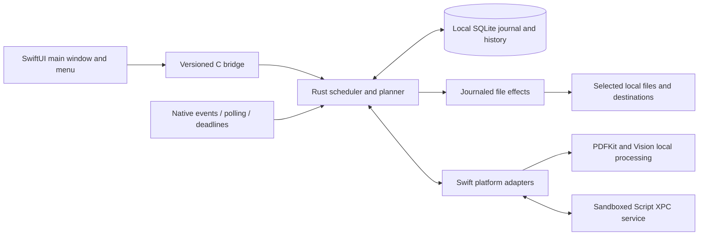
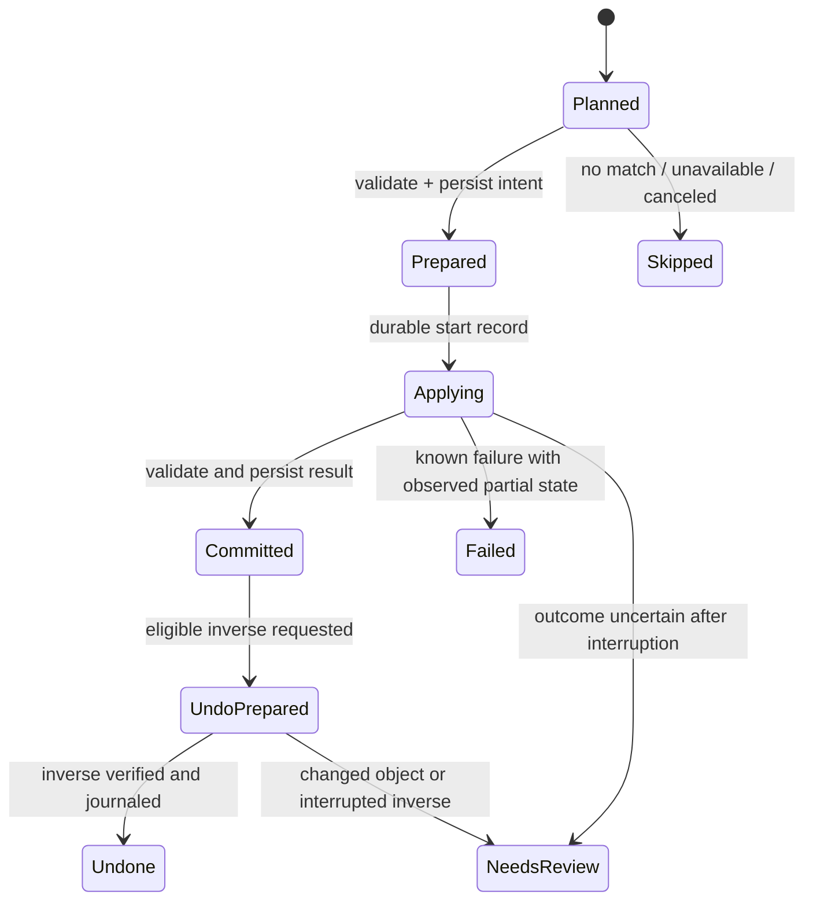

# Folder Master — Technical Design Document (TDD)

Version 0.1 · 11 November 2026 · Status: architecture baseline; M1 foundation implemented in part. See progress for current build/runtime evidence.

## Context

See [proposal](proposal.md) for motivation, [PRD](../../../docs/PRD.md) for product requirements, [flows](../../../docs/USER_FLOWS.md), [options](../../../docs/USER_OPTIONS.md), and [UI/UX design](../../../docs/UI_UX_DESIGN.md) for the experience contract. The [updated goal](../../../docs/GOAL.md) explicitly prioritizes UI, UX, animations and transitions. At initial design inspection, the workspace had OpenSpec scaffolding but no app source, build targets, tests, dependencies or existing capability specs. The current M1 foundation adds a Rust static library, native app/test targets, schema-v1 storage/exclusive ownership, real disabled folder setup and a separate synthetic storyboard; [progress](../../../docs/PROGRESS.md) distinguishes this from completed product behavior. No existing product behavior needs migration.

Confirmed architecture boundary: Rust engine, SwiftUI/AppKit UI, macOS 14+ deployment target, direct distribution. Apple APIs and Rust watcher evidence are linked in [RESEARCH.md](../../../docs/RESEARCH.md). Proposed module/API names below describe future code, not current files or verified SDK integration.

## Goals / Non-Goals

**Goals:** a deterministic planner shared by preview and execution; a small explicit Rust/native boundary; journaled filesystem effects with conservative undo; bounded content work; native platform integrations; independent offline script isolation; recovery without blind side-effect replay.

**Non-goals:** a webview/Electron/Tauri UI, Rust-only GUI, general plugin system, administrator service, full event-sourcing framework, remote API, file content database/search index, distributed transactions, or an exactly-once claim for arbitrary filesystem/script effects. Do not introduce background network dependencies or unrestricted scripts to resolve a platform limitation.

## Decisions

### D1. Native shell and Rust core, linked through a narrow C ABI

Use SwiftUI for scenes, tables, forms and state presentation; AppKit/Foundation adapters where native panels, file semantics and accessibility need them. Use a menu-style `MenuBarExtra`, singleton management `Window`, Settings scene, and accessory activation policy/`LSUIElement` so closing the window does not quit. Explicit Open Window activates and focuses the management window. Start-at-login uses `SMAppService.mainApp`; no custom LaunchAgent.

Build the engine as a Rust static library for arm64 and x86_64, linking one matching slice per app build and combining app architectures for release. Pin toolchain and dependency versions during M1; do not equate Rust with automatically fast filesystem/OCR operations. CPU work stays off the main actor; I/O, queue bounds and OCR scheduling dominate perceived performance.

Prefer a hand-maintained small C header with schema-versioned JSON command/event envelopes over generating a large interop layer. Candidate exported operations: create engine, submit command, poll events, cancel request, release buffers, destroy engine. Swift uses one serial bridge queue; calls enqueue work and return immediately. A timer/event wakeup drains bounded event batches and hands view-model updates to the main actor. No synchronous main-thread wait for content or filesystem effects.

Boundary contracts:

- Opaque handles; explicit owned byte buffers and one Rust release operation; zero borrowed Swift pointers retained beyond a call. Errors are typed envelopes, not sentinel strings.
- Protocol version, request ID, payload schema, bounded envelope size (1 MiB), structured error code/reason/retry guidance. File contents travel by local file handle/URL to adapters, not large JSON blobs. Output manifests stream/paginate.
- Lossless filesystem paths represented by bytes (base64 in envelopes) and separate display strings. Non-UTF-8 filenames remain operable. Input templates remain UTF-8; no lossy path conversion or C-string truncation.
- Panic containment at every Rust export; no unwind crosses FFI. Report fatal engine failure and stop scheduling mutations. Swift lifetime teardown waits for engine acknowledgements off main actor. Event overflow coalesces progress; durable results remain queryable from storage.
- Engine requests platform work as asynchronous `PlatformRequest` IDs; Swift dispatches to adapter queues and submits results through the command channel. Exactly one result/cancel completion per ID; rule/execution state remains in Rust. No callback reentrancy into active engine locks.

Alternative: Tauri would reuse Rust but introduce a webview and JS/native bridge without a user-requested cross-platform benefit. Rust AppKit bindings could reduce Swift but increase UI/Apple-framework ownership complexity. A large generated FFI library remains an option if the small bridge becomes impractical; changing it cannot change product contracts.

### D2. Separate pure domain planning from platform effects

Proposed source layout:

```text
native/FolderMaster/             SwiftUI scenes, view models, app lifecycle
native/PlatformAdapters/         bookmarks/permissions, UTType, tags/labels,
                                PDFKit/Vision, Trash, file coordination
native/ScriptService/            signed, sandboxed offline XPC runner
engine/crates/domain/           typed rule AST, tri-state matcher, templates
engine/crates/runtime/          watcher/reconciliation, deadlines, scheduler
engine/crates/operations/       planner, filesystem effects, archives, undo
engine/crates/storage/          SQLite migrations, journal, history, receipts
engine/crates/bridge/           C ABI and command/event serialization
tests/fixtures/                 synthetic metadata/text/PDF/image/ZIP fixtures
docs/                           product and progress artifacts
openspec/changes/build-folder-master/
```

This is a dependency map, not an instruction to scaffold every crate before useful behavior exists. Domain can begin as modules in one engine crate; split only when it reduces dependency coupling. Domain depends on typed snapshots and effect descriptions, never Swift classes or filesystem APIs. SQLite ownership is entirely Rust; Swift queries through engine commands. Swift adapters have no duplicate matching, ordering or undo policy.



Suggested dependency roles: `serde`/JSON for envelopes, `notify` for watchers, SQLite via `rusqlite` for durable state, `regex` for bounded regex syntax, a ZIP read/write implementation with streaming and explicit entry validation. Exact versions, MSRV, license audit and ZIP metadata preservation are M1/M3 selection tasks. Favor standard Rust threads/channels and a small worker pool; add an async runtime only if measured integration warrants it. Avoid shelling out for built-in move/copy/archive actions.

### D3. Local persistence and versioned data model

Primary storage: `~/Library/Application Support/Folder Master/` outside synced document folders, user-only directory access. SQLite in WAL mode with foreign keys, serialized writes and durable journal commits (`synchronous=FULL` for mutation journal boundaries). Settings, rule ASTs and envelopes are schema-versioned. No raw file contents in the main database.

| Entity | Key fields and invariants |
| --- | --- |
| Folder | UUID, display name, bookmark/identity, enabled, recursion, hidden/exclusion options, watch mode/interval, baseline generation, availability |
| Rule revision | Stable rule UUID + revision, folder UUID, position, enabled, condition AST, action array, stop/continue, capability approvals, created timestamp |
| File snapshot | Volume/resource identity, raw path, size, nanosecond times where available, stat generation, kind, tags/label status, content completeness/source; unknown reasons explicit |
| Plan / row | UUID, trigger, pinned config revision set, plan clock/timezone, file preconditions, selected complete chain, output paths, conflicts, action-specific undo expectations |
| Run | UUID, automatic/manual/test/undo/recovery trigger, scope, start/end, summary, cancel state |
| Operation journal | UUID, run/file/step index, dependencies, before-state, intent, temp/output identities, state, after-state, timestamps and recovery evidence |
| History | Durable outcome and explanation, rule revision reference, input/output manifest, error, undo eligibility and expiry |
| Receipt | File version + rule revision + run provenance and latest observed output fingerprint; prevents duplicate processing of unchanged app outputs |
| Deadline | File/rule identity, next due instant, last-evaluated version and temporal truth signature |
| Capability approval | Rule revision configuration hash, script/interpreter hashes when applicable, acknowledgement time; global allow flags remain separate |

Keep unresolved journal records independent of user-deletable history. Foreign keys cannot strand recovery metadata when removing folder/rule configuration; retain revision snapshots needed by existing operations. Clearing history drops completed undo references but preserves user files and unresolved recovery entries. Retention prunes complete records in batches, never during a conflicting undo. Reconcile the journal before watchers execute at startup.

Acquire an exclusive kernel-backed advisory lock on the canonical app data store before opening a writing engine or recovering journals; hold its descriptor for the engine lifetime. Atomic startup ownership must cover every app copy/version. A second process cannot recover or mutate that store: it activates the existing same-user app instance when possible, otherwise presents a non-writing explanation. Kernel lock release handles process death; do not infer ownership from a stale PID file or delete another process's live lock.

Baseline/deadline/receipt state is active-scope operational state, not history subject to thirty-day pruning. Compact it to current file versions and live rule/time signatures; remove obsolete revisions only after active chains drain. Inventory is disk-backed/paginated, with no full-tree RAM requirement. Removing a scope removes live eligibility state but retains unresolved recovery evidence. This avoids history cleanup reviving unchanged outputs or losing future date eligibility.

Content cache, if explicitly enabled: separate user-only cache keyed by strong file fingerprint, extractor/OS revision, OCR settings/languages and schema version; 7-day/100-MiB LRU cap. Default memory-only cache cap 32 MiB. Record content completeness to prevent reuse of partial text as complete. Cache keys invalidate on file generation/content changes and relevant metadata/config changes. Clear cache cancels or invalidates matching in-flight results.

No application-level encryption promise. OS account security/FileVault provides at-rest boundary. Avoid secrets/document text in unified logs, crash output, exports and Git. Full paths remain in local history per PRD, disclosed to the user.

### D4. Watchers are hints; reconciled snapshots establish work

Use `notify`'s macOS native backend by default and polling on user-selected unsupported volumes. The researched stable candidate is Notify 8.2.0; newer branch examples are not a version commitment. The chosen pinned release must be checked for rescan indications and symlink defaults. Configure no symlink traversal explicitly.

Register watches before enumerating; then reconcile events received during the baseline scan. First enrollment records baseline without effects. Later launch/wake/resume compares baseline/snapshots and plans changed/new eligible files, plus due time conditions. Reconcile on watcher rescan/error, root/volume changes and a 15-minute low-priority sweep for local scopes. A bounded 10,000-candidate queue coalesces by file identity; overflow marks scope dirty and schedules rescan rather than silently dropping eligibility.

Detect duplicate/overlapping watch roots using canonical identities and ancestry; reject new overlaps whether or not current recursion is on to avoid ambiguous ownership later. Do not traverse directory symlinks, Finder aliases, packages, temp/staging/Trash, or app data. Bind a watch to directory identity, not just a path that might later be reused by another object. Only local mounted volumes are in scope: verify native volume-locality at enrollment and again before reads/publication. Reject SMB/NFS and uncertain remote roots, destinations, script/interpreter and export paths. Polling supports unreliable local filesystems; it does not authorize remote storage.

Debounce/coalesce event bursts, then sample size+mtime at least 2 seconds apart. Disregard partial download extensions. Recheck immediately before each effect. This cannot prove that another program has closed the file; no such claim appears in UI. An actively changing file is deferred, not repeatedly failed. Local-only availability checks occur before reads; never call a cloud download API. Coordinated platform reads avoid intentionally forcing cloud hydration; if local availability cannot be determined safely, skip content processing with a reason.

Per-file serialization includes all rule steps. Destination reservations serialize same-target effects across files; volume-specific name equivalence is authoritative. Default one mutation worker and one content worker; normal mode permits two mutation and two content workers, but at most one OCR request per app. Keep file lock bookkeeping bounded and release when work drains.

Receipts suppress exact output versions from move/copy/rename/tag/ZIP/extract/undo across all watched folders, including app-created copies. Persist through restart. Subsequent external changes clear suppression for that new version. Unchanged files do not rerun merely because an event repeats or an age condition remains true. Explicit Run Now bypasses receipt eligibility for selected existing files but still runs normal safety checks. An age predicate crossing a boundary produces one new temporal eligibility signature; it is not retriggered every minute.

On enrollment or rule enable/revision change, record temporal truth for unchanged historical files without executing already-true predicates; Run Now is required for those. Only subsequent false→true eligibility transitions schedule automatic time work. While paused/asleep, retain previous truth/deadlines so resume/wake can catch transitions missed during that interval. Do not reinterpret an already-past age deadline as an immediate destructive initial run.

### D5. Typed three-valued rules and a single planner

Condition AST: `All(children)`, `Any(children)`, `None(children)`, or typed `Predicate(field, operator, value, options)`. Validate operator/field compatibility, maximum depth 3, 50 predicates, 20 actions, nonempty groups, valid regex and templates. Rule defaults/case/units/types are defined by the option catalog.

Each predicate yields True, False, or Unknown(reason). All/Any/None implement the catalog's three-valued truth tables. Short-circuit cheap predicates before requesting text where semantics allow; do not reorder action execution. Unknown cannot be converted into False before negation. A partial result can prove positive literal substring containment; regex (including end anchors/boundaries) and negative text results require complete extraction in 1.0. A rule whose result is Unknown records the explanation and performs no actions; later independent rules remain eligible.

Snapshot metadata includes both raw UTType/conformance and user-facing kind mapping. Date source unavailability is explicit. Tag names and color label are distinct UI fields; Foundation handles actual metadata and post-write roundtrips. Finder can couple color tags/legacy label representation; a tag/label action snapshots and verifies both, and preview must expose related changes detected by the platform adapter rather than pretending they are independent storage.

Planner inputs: immutable snapshot(s), selected scope, pinned rule revisions, destination metadata, capability state, stable batch ordering, captured clock/timezone and optional extraction results. Planner output: per-file ordered effect graph, preconditions, secondary outputs, conflict/status explanations and inverse descriptors. Preview runs the same planner with effects disabled; destination inspection is read-only. No actions create directories or call scripts during planning.

Continue semantics: perform a chain on the current file; project move/rename/tag metadata; then evaluate later rules. Copy/ZIP produce secondary outputs and keep current source. Only forward rule positions are considered in this evaluation, preventing a within-pass backward loop. Uncompress, Trash, delete, scripts terminate. Move leaving original scope completes that rule's remaining preapproved actions under its authorized destination context, then terminates later-rule evaluation. If platform post-state differs from projection or unknown script effects would be required, stop and require replan rather than follow a speculative chain. Draft testing has no execution token.

Template compiler exposes only the documented tokens/date format subset. Name pieces cannot contain separators/traversal/NUL; relative subfolders are normalized beneath the authorized root using directory-relative handles. Plan chooses deterministic counter values from stable bytewise relative-path order; executor reserves concrete outputs and rechecks conflicts. No environment interpolation, shell substitution or content-derived executable code.

### D6. Action journal and filesystem commit protocol



Before a chain starts, validate current rule revision and preflight all guarded capabilities, required permissions/available destinations and known safety restrictions. A missing capability or unsafe multiply-linked metadata action blocks the entire chain before any effect. Once started, retain the pinned revision across rule content edits, but honor live disable/pause/capability revocation at safe boundaries. Pending/unstarted chains invalidate on revision/reorder changes.

Every mutating step: acquire file/destination ownership → fresh expected evolving-file snapshot and live enable/capability checks → durable intent/unique staging names → perform action → verify actual post-state → durable result/receipt → emit UI event. Fail to persist intent: do not perform effect. Fail after effect but before result: stop scheduling mutations; recovery inspects files and intent. Database transactions cannot make filesystem operations atomic with SQLite, so each recoverable intent includes enough before/after evidence to classify reality.

Use no-replace atomic publication on macOS (platform no-replace rename primitive or equivalent verified adapter), not `exists()` followed by a replacing rename. Inspect targets and parents using non-following descriptor-relative operations, verify root identity and containment immediately before use, and reject symlink/hardlink escapes. Resolving a path once is insufficient against a subsequent swap. Reserve generated output names per action; conflicts at publication are new conflicts, never overwrite. Persist exact outputs, not just string templates.

Action implementation contracts:

- **Move/rename on same volume:** atomic no-replace rename; record identity and original parent. Case-only rename on insensitive volumes uses a unique intermediate path and journal. No-op same identity is recorded without repeated mutations.
- **Cross-volume move:** copy into destination-volume private temporary sibling, stream and verify byte count/content hash and required metadata, sync, no-replace publish, revalidate source version, then unlink source. Preserve tags/label and relevant xattrs/resource forks/permissions to the extent supported; if required preservation fails, retain source and fail/mark partial. Source unlink failure leaves both files and records partial, never declares a completed move. Do not assume cross-volume rename.
- **Copy:** stream to destination sibling, verify, preserve supported metadata, publish without replacement; original remains current. On a changing source, stop publication or mark a separately identified incomplete temp; never delete the source. Built-in copies retain system quarantine metadata.
- **Tag/label:** Foundation resource-value adapter reads before state, rejects multiply-linked inputs (`nlink > 1`) because metadata updates could affect out-of-scope links, applies explicitly requested changes, roundtrips both tag and label representation, and records actual after state. Recheck link count before effect; if it changes, stop. Permission/volume inability fails visibly. Roll back only when known safe; multi-key partial changes are recorded as partial and recoverable. Move/rename/unlink act on the selected directory entry only, without modifying shared file bytes.
- **Compress:** stream one file into ZIP temporary output, include supported metadata through a tested ZIP representation, verify archive, publish as secondary. Byte contents are lossless; Finder metadata preservation in ZIP is a platform proof requirement before release, with any unsupported fields explicitly documented. Keep source.
- **Extract:** ZIP-only parser, reject absolute paths, `..`, unsafe normalization, symlinks/hard links, devices, duplicate/case-equivalent names, encrypted/unsupported entries and archive escape. Limits: 10,000 entries, 10 GiB expanded bytes, 1000:1 expansion ratio, 20 nested path components. Never recurse automatically into extracted archives. Extract into a fresh staging tree, validate actual bytes/CRC and file count, then publish a new named directory without merging; keep source. Pre-existing destination triggers folder conflict policy as a whole.
- **Trash:** Foundation `trashItem` adapter; record returned actual Trash URL and identity (name may change). On unsupported volume/failure do not fall back to permanent deletion. Trash is terminal.
- **Permanent delete:** opt-in and exact snapshot validation, unlink only selected regular directory entry, not recursive removal; record no undo. Revalidate capability at step boundary.
- **Script:** D8; isolate and stage first, no script retry after uncertain execution. Publish only validated outputs with normal journal/conflicts; script outcome and output publication are separate recorded phases.

Cross-volume/preservation paths should use platform copy primitives or explicit stream+metadata adapters selected after M1 proof; pure `std::fs::copy` alone is not accepted as evidence of Finder/xattr/resource-fork parity. Built-in output metadata verification is independent of byte verification.

### D7. Undo is conditional compensation, not time travel

An inverse describes object identities, required current paths/content versions, metadata after-values, original path vacancy and dependencies. Eligibility is computed fresh; history's old “undoable” marker is only a hint. Fingerprints include volume/resource ID, size, mtime/metadata generation plus strong content hash for supported byte-changing/output operations. A matching inode alone is insufficient because in-place edits reuse identity. Hash inputs/outputs on streaming operations; hash move/rename/Trash targets for a durable inverse when they are within supported read bounds, otherwise explicitly mark Undo unavailable until a safe fingerprint can be produced. Do not postpone a destructive action merely to imply undo support.

Native file leases/coordination plus snapshot checks reduce races; macOS cannot lock out all uncooperative external writers. Recheck after effects, keep ambiguous records as Needs review, and never advertise unconditional preservation against concurrent hostile mutation. Supported verification uses synthetic concurrent-writer tests and conservative failure.

Inverse semantics:

| Forward operation | Inverse / verification |
| --- | --- |
| Move / rename / Trash | Move exact unchanged output back to original free path; cross-volume inverse uses the same verified copy protocol |
| Copy / ZIP | Remove only exact unchanged generated output via a journaled temporary holding path; commit removal; retain restoration info through inverse commit |
| Tag / label | Restore affected before-values only if affected current values equal recorded after-values; preserve unrelated metadata changes |
| Extract | Validate entire output manifest first; remove owned unchanged files; remove empty owned directories only; foreign contents block whole-chain undo by default |
| Delete / script | No automatic inverse |

Undo chain order is reverse dependency order, including later runs touching the same identity. A non-reversible step is a barrier; offer only safe suffixes or individually eligible operations with no unresolved dependencies. Undo is journaled as a new run, with its own partial failure and recovery states. No redo. Undo outputs receive suppression receipts to avoid immediate reapplication. External edits, a reused path, emptied Trash, missing volume, expired history, or unknown recovery state block the inverse with specific reasons.

### D8. Local text/OCR and restricted script service

**Content pipeline:** cheap metadata first → UTF-8 text streaming or PDFKit per-page text → optional Vision OCR → typed content result. PDF rasterization uses PDFKit/CoreGraphics; Vision receives local raster images through `VNRecognizeTextRequest` available on macOS 14. Use the older supported API rather than newer OS-only conveniences. Embedded-then-OCR processes each page without usable text, preserving mixed text/scanned documents. Force OCR handles scanned regions mixed into otherwise text-bearing pages. Track total/processed pages, truncation, decoding and OCR errors separately.

Result contains source, Complete/Partial/Unsupported/Failed status, bounded text, page evidence and error. Empty complete text is valid; empty unsupported text is not. Preserve per-file/captured settings in cache keys. Supported images/formats/limits are the option catalog; process multipage TIFF frame-by-frame. Downsample to 20 megapixels, process one page at a time, cap PDF pages/text/time/input bytes. On timeout/over-limit, retain proven positive evidence but never infer absence. No document rewrite, cloud API or model download. OCR languages come from runtime-supported choices, not hardcoded promises.

**Scripts:** a separately signed App Sandbox XPC service with no network client/server or automation/Apple Events entitlements. Main app remains a direct-distribution, non-sandboxed per-user app with TCC restrictions; it does not grant unrestricted filesystem/network powers to the service. Each job gets input bytes/metadata and approved script/interpreter bytes staged in the service's own local container. Script reads a staged file, not original watched paths; the host exposes no generic filesystem/command/network callback to the helper. It can return only bounded status/logs and regular-file output manifests from the per-job output directory. Host independently verifies outputs and publishes under the one declared destination root.

Interpreter launch uses argv, scrubbed environment, per-job HOME/TMPDIR/work directory and no profile startup files. Bundle/system interpreter paths are allowlisted; custom local interpreters require content-hash approval and compatibility tests. Child execution must retain the service sandbox, including process descendants; kill the process group on timeout/cancel and terminate the service if descendants cannot be accounted for. Prevent IPC to unsandboxed app automation/launch services; do not offer inherited privileged handles or writable original paths. Check service/client signing identity and validate secure XPC classes/message bounds.

Resource bounds: 1 GiB input staging, 1 GiB aggregate outputs, 1,000 output files, 1 MiB logs, 30-second default/600-second maximum execution; enforce staging/output quota externally rather than trusting a manifest. Use per-job service/container cleanup, no cross-job script data reuse, cleanup completed staging immediately; failed staging can be retained explicitly for local inspection up to 24 hours within a 1-GiB total diagnostic cap. Never keep a full source copy in history. Script publications have no automatic undo promise in 1.0.

**Mandatory early gate:** sign and test XPC sandbox + system interpreter/custom executable execution on macOS 14 and current macOS. Prove no network egress, forbidden original-file writes, unsafe IPC or child escape; prove normal staged scripts can publish allowed outputs. Apple documents independent service sandboxes; it does not establish this complete script design as already working. If the gate fails, stop the script milestone and revise the mechanism while preserving the offline contract; do not enable unrestricted fallback or mark full 1.0 complete. A language feature incompatible with isolation is unsupported with a specific error.

Current evidence: the separate [script proof](../../../docs/SCRIPT_PROOF.md) passes staged zsh, literal argv, original-access denial and output rejection cases on the current arm64 host. Its unentitled exact-binary child probe has direct network access denied but can look up Launch Services. That fails the planned IPC-denial gate; a lookup alone is not proof of a brokered upload. Task 1.5 remains open and scripts are not integrated into the product. Ad-hoc client bundle-ID checking is not a release signing anchor. Investigate a supported stronger mechanism and revise this decision before integration; preserve script/interpreter compatibility and seek an explicit product decision if a candidate would narrow it.

Alternatives rejected: executing arbitrary `sh -c` in the main app violates privacy and command-boundary requirements; removing network entitlements from a non-sandboxed process does not deny network; undocumented/deprecated sandbox profiles are not the primary release strategy. A WASI-only runner would narrow script compatibility materially, so it would require a documented product revision rather than a silent substitution.

### D9. Native UI state, permissions, errors and cancellation

View models receive engine snapshots/events and send commands; command success is not inferred before acknowledgements. Saved configuration and dirty editor state are distinct. Persist pause/timed deadline and capability state; no effects start just because a view appears. Global/folder/rule enable states combine conjunctively except a visibly confirmed manual one-time pause override.

Folder selection uses NSOpenPanel plus persistent URL bookmarks/file resource identity. Because the host is not sandboxed, bookmarks primarily track locations, not a claim of authorization beyond TCC. Handle stale bookmarks/moved roots and balance scoped access only where actually applicable; no invented sandbox entitlements for the host. User action to grant protected-folder access is explained with exact failure. Automation/Accessibility/Full Disk Access are not requested as a default fix. Volume remount/reused paths require identity checks.

Errors cross the bridge as codes with affected operation/path, human explanation, retryability and next action. Logs use IDs, not file contents; script logs remain local and capped. Meaningful failures/partial effects persist; routine no-match filesystem noise is aggregated. OS notification denial does not hide in-app errors.

Pause/cancel stops new mutating steps after a current safe boundary, cancels queued content tasks, and records the partial chain. Streaming copy/OCR checks cancellation between chunks/pages; temporary staging is safely cleaned where ownership is proven. Atomic publication/unlink cannot be interrupted halfway. Quit drains at a safe boundary with timeout-to-recovery policy internal to shutdown, never pretending canceled work rolled back.

### D10. Build, release and Git progress

Build locally with Xcode command-line tooling and a pinned Rust stable toolchain; capture actual versions in the first implementation commit. Set `MACOSX_DEPLOYMENT_TARGET=14.0` for every native/helper/Rust target, verify linked dependencies and architecture slices. Keep Rust static code and helper signing inside the app build. Hardened Runtime for release; App Sandbox only for the isolated script service unless later explicitly redesigned.

Direct release: sign inside-out with Developer ID, inspect entitlements, archive a distributable artifact, notarize with current Apple tooling, staple tickets, validate Gatekeeper on a quarantined downloaded copy and test offline launch. Signing/notarization credentials are external prerequisites. Developer release upload contains the app artifact only; no user's watched file data. No automatic update client in 1.0. Development can proceed with local signing without claiming a public-ready notarized release.

Git workflow: `main` holds reviewed baselines; use focused `feat/<milestone-topic>` branches for subsequent implementation, review before merging; no remote/push unless requested. Commit coherent working increments with relevant task IDs and check evidence. No Jira integration or issue key requirement exists in this greenfield workspace. Keep unrelated installed `.agents` skill content intact and outside authored product commits. Update [PROGRESS.md](../../../docs/PROGRESS.md) and the task checklist only with observed outcomes. Do not check implementation tasks because documents exist. Archive OpenSpec only after full acceptance.

### D11. UI, UX and motion as an early engineering workstream

Use [UI_UX_DESIGN.md](../../../docs/UI_UX_DESIGN.md) as the shared screen/state/motion contract. Build a disposable in-app presentation-state prototype during M1 using synthetic data, before scaling action implementation; label simulated states so they cannot be confused with engine results. Implement and review key transitions there, then reuse its view components and tokens with real acknowledged state.

Prefer semantic macOS typography/colors, native control sizing, an 8-point spacing rhythm and native presentation over custom chrome. Selection and inspector identity remain stable during list updates. Preserve scroll/focus and avoid view identity resets merely to replay animations. Large preview/history lists use virtualization and animate user-scoped changes only; coalesce bulk progress updates at most four times per second while ensuring final/error state is delivered promptly.

Use short explicit SwiftUI transactions for designated presentation changes. Quick feedback targets 120 ms, structural changes 180 ms, contextual result transitions 220 ms; app-authored transitions cap at 300 ms. These are design values to measure, not observed timing. Respect `accessibilityReduceMotion`; combine system preference with app Follow System/Reduced/Off, choosing the more restrictive behavior. Reduced removes displacement/scale/spring motion and permits opacity up to 100 ms; Off applies presentation immediately. Native system panels remain controlled by macOS.

Separate command lifecycle from animation: command enqueue → Pending → acknowledged engine state → visual result. Never delay permissions/cancel/focus for completion callbacks, never mark a file action successful because a checkmark animation ended, and never optimistically show destructive success. Pause can show pending feedback while a safe step drains. Cancel/interruption/new selection replaces motion from the currently presented state without stacking transitions. No confetti, blinking error badges, permanent menu-icon animation or automatic focus theft.

Experience gates: review core screen states and flow storyboard in M1; perform keyboard, VoiceOver, reduced/off motion, large-list and interrupted-transition checks as components integrate; repeat full-flow acceptance in M4/M5 only when real engine behavior is wired. Track visual/usability evidence in progress alongside runtime correctness. Optional later visual prototyping may be used after the planning review; no prototype is claimed to exist yet.

## Verification strategy

TDD here is a technical design, not a requirement to impose a test-first workflow. Add behavior tests at the boundaries where data loss, incorrect matching, unsafe preview or privacy regression is plausible; use manual native checks for visual/native flows.

| Layer | Required checks | PRD / specs |
| --- | --- | --- |
| Pure domain | Every operator family, Unicode/case/regex, unit/range validation, three-valued groups and negation, captures, template sanitation, deterministic order/counters, temporal deadlines/DST | FR-03/04; rule-engine |
| Planner | Preview/execution plans identical for same inputs; no calls to effect/script executor in dry-run; continue/current vs secondary semantics, terminal actions, partial content | FR-05/07; file-actions, preview-execution |
| Filesystem integration | Temp local APFS roots, all actions; duplicate/case names; xattrs/tags/label/quarantine; cross-volume move; source mutation; symlink/parent swaps; full disk; permission/revoked access | FR-01/02/05/12; watched-folders, file-actions |
| Journal/recovery | Inject interruption before/after each durable boundary and publication/unlink; recover known commits, preserve ambiguous states, block duplicate script/delete | FR-10/11; history-undo |
| Undo | Every supported inverse, reverse dependencies, in-place content edit with same inode, old path occupied, missing Trash/volume, foreign extraction files, expired retention | FR-10; history-undo |
| Content/OCR | Synthetic UTF-8, text PDF, scanned PDF, mixed pages, force OCR regions, multipage image, unsupported/protected/corrupt inputs, language support, limits/cancel, complete-empty vs unknown | FR-06; content-ocr |
| Scripts/privacy | Signed sandbox runner, child descendants, network/IPC/forbidden-write denial, staged normal script, approved hash change, literal path injection, output-quota/traversal, timeout, no preview invocation | FR-13; local-runtime |
| Native manual/UI automation | Each documented flow; first launch/cancel, dirty editor, focus/keyboard/VoiceOver, menu toggles/paused run override, login approval denied, close vs quit, history/undo | FR-08/09/14/15; native-app |
| UI/UX and motion | Screen-state coverage, native hierarchy, focus/scroll stability, timing traces, interrupted transitions, reduced/off behavior and large-list motion limits | FR-16, NFR-09; native-app; UI_UX_DESIGN.md |
| Stress/performance | 10k metadata fixture, burst/overflow recovery, idle sample, bounded queues/cache, large copy and OCR responsiveness | NFR-02–07 |
| Distribution | arm64/x86_64; macOS 14 and current OS; helper entitlements, signed/downloaded/quarantined/offline artifact, Gatekeeper/notarization | NFR-01/08 |

Tests must use disposable fixture directories rather than user's actual Downloads. Destructive operations require explicit fixture scope. State clearly which physical OS/volume/architecture checks are unavailable; a successful Rust unit suite does not prove Finder metadata, menu behavior, OCR accuracy, TCC, signing or recovery under real power loss.

## Risks / Trade-offs

- [Script sandbox compatibility and descendant isolation] → Required M1 signed-service proof; block script release if unproven; preserve staged/offline boundary.
- [Native events coalesce/drop; polling misses transient states] → Start watchers before scan, reconcile snapshots, dirty-scope fallback and disclosed polling limitations. Promise final-state eligibility, not capture of every transient file version.
- [Concurrent external writers bypass app locks] → Descriptor/identity checks, no-replace commits, output verification and conservative recovery/undo; avoid an absolute exactly-once/no-race claim.
- [FS + SQLite cannot share an atomic transaction] → Durable intents, unique staging, crash injection and explicit ambiguous outcomes.
- [PDF OCR latency/accuracy and mixed-page semantics] → Demand-driven bounded pipeline, complete/partial statuses, force OCR option, no guaranteed recognition claim.
- [Finder labels/tags differ across volumes and ZIP metadata is subtle] → Native adapter, roundtrip fixtures and early preservation proof; document supported fields before release.
- [Non-sandboxed host has broader per-user permissions] → App-level selected-root containment, no network feature, sandbox scripts separately, no privileged service; TCC remains authoritative.
- [Local folders can be synchronized by other apps] → Never request hydration; disclose sync boundary; no claim to control third-party uploads.
- [Fingerprinting large files costs I/O] → Streaming reuse, cache versioned fingerprints, bounded concurrency; explicitly unavailable undo where safe evidence is absent.
- [Intel/macOS 14 test machines or signing credentials may be absent] → Keep those release gates Not run; local app progress does not satisfy them.

## Migration Plan

Greenfield application: no prior user schema migration. M1 creates schema v1 through explicit versioned SQL migrations. Later versions back up the database with a WAL-safe SQLite backup mechanism, apply transactional migrations, and retain last known-good backup. Before backup/restore, quiesce engine mutations. Never copy a live SQLite main file alone and assume the WAL was included.

On schema failure, preserve original database, stop automation and show recovery choices. Older binaries seeing a newer schema open help/recovery state with no writes; no automatic downgrade. Restore from backup only after confirming no unresolved operation journal would be lost. Engine/app rollback must not reverse user file changes implicitly. An implementation change that changes rule behavior updates revision/schema plus OpenSpec scenarios before release.

## Deferred implementation details

Builder-owned decisions: exact pinned Rust/Xcode versions and SQLite/ZIP crate versions after compatibility/license checks; final SF Symbol, app icon and bundle identifier; whether internal engine modules warrant crate splits; exact VoiceOver phrasing. They do not change behavior or task ordering. Platform compatibility proofs are mandatory tasks with explicit fail outcomes, not claims already established by documentation. Public signing identity/credentials are supplied only when preparing distribution.
